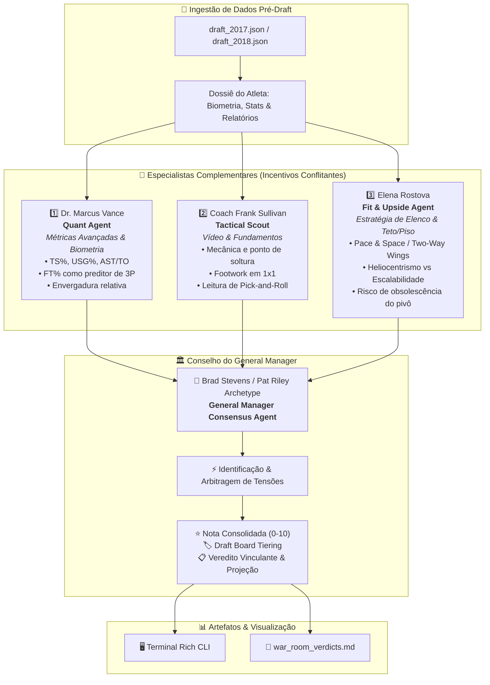

# 🏀 NBA Draft War Room (2017-2019): Multi-Agent Autonomous Scouting System

> **Um sistema multiagente de inteligência artificial inspirado na mecânica PokéIA de especialistas complementares e consenso executivo deliberativo.**
> 
> *Estudo de caso técnico de alto impacto aplicando IA Autônoma, Engenharia de Prompts Conflitantes e Modelagem Esportiva Avançada para simular decisões de centenas de milhões de dólares no Draft da NBA.*

---

## 🚀 1. Visão Geral do Projeto

No esporte profissional de alto rendimento, o recrutamento universitário é um dos ambientes de maior incerteza e custo de capital do planeta. Em 2017 e 2018, franquias da NBA cometeram erros históricos de avaliação:
- O **Sacramento Kings** selecionou Marvin Bagley III em #2 e passou por **Luka Dončić**.
- O **Phoenix Suns** gastou a pick #1 em Deandre Ayton, ignorando um MVP da EuroLeague de 19 anos.
- O **Philadelphia 76ers** trocou escolhas futuras para subir para #1 e selecionar Markelle Fultz, enquanto Danny Ainge e o Boston Celtics desceram para #3 sabendo que **Jayson Tatum** era o melhor jogador da classe.

O **NBA Draft War Room** reproduz o processo de deliberação de uma diretoria da NBA através de **três agentes especialistas autônomos com incentivos e vieses conflitantes**, cujos pareceres técnicos são arbitrados por um **General Manager (GM)** executivo.

---

## 🏛️ 2. Arquitetura Multiagente (Padrão PokéIA)

O sistema opera sob o conceito de **deliberação colegiada assimétrica**: em vez de um único modelo generalista emitir uma opinião rasa, múltiplos agentes especializados atacam o problema com prismas complementares e incentivados a discordar.



### Personas e Conflitos de Incentivo:
1. **Dr. Marcus Vance (Head of Advanced Analytics & Biometrics)**:
   - *Incentivo*: Cético implacável com volume em ligas fracas; busca eficiência pura ponderada pela qualidade da oposição (TS%), valor preditivo de lances livres (FT%) e anomalias de envergadura.
   - *Conflito*: Despreza pontuações brutas de atletas em times perdedores e penaliza arremessadores com baixo FT%.
2. **Coach Frank Sullivan (Director of Scouting & Film Study)**:
   - *Incentivo*: 30 anos observando vídeo de ginásio. Analisa a biomecânica fina do tiro, fluidez de quadril, rotações defensivas e dependência motora (ex: prospectos com apenas uma mão útil).
   - *Conflito*: Entra em choque com o analista de dados quando métricas puras ignoram uma mecânica de tiro quebrada ou instabilidade articular.
3. **Elena Rostova (VP of Roster Strategy & Ceiling/Floor Projection)**:
   - *Incentivo*: Adaptabilidade à NBA moderna (trocas de marcação, gravidade perimetral e valor de reposição posicional).
   - *Conflito*: Rebaixa agressivamente pivôs tradicionais de garrafão (mesmo com números universitários altos) e prioriza *two-way wings* e criadores primários.
4. **General Manager (Decision Consensus Agent)**:
   - *Missão*: Confrontar as zonas explícitas de tensão, ponderar trade-offs de dezenas de milhões de dólares e emitir a nota consolidada (0 a 10) e o veredito oficial do Draft Board.

---

## 🏆 3. Casos de Validação Empírica: Por que a IA acertou onde humanos erraram?

### 💡 Caso 1: Por que a IA teria escolhido Luka Dončić em #1 em 2018?
- **A Armadilha do Olho Humano (Phoenix e Sacramento)**: Os olheiros tradicionais foram seduzidos pelo porte de estátua de Deandre Ayton e pelo segundo salto acrobático de Marvin Bagley III, rotulando Luka com a narrativa preconceituosa de "atleta europeu lento".
- **O Peso da Oposição Ponderada (Dr. Vance - Quant)**: Aos 19 anos, Luka registrou um BPM projetado de **`+14.5`** enfrentando homens adultos e ex-jogadores da NBA na EuroLeague e Liga ACB. Nenhum prospecto universitário da NCAA enfrentou essa densidade tática e física com 25.9 minutos por jogo.
- **A Morte do Pivô Tradicional (Elena Rostova - Fit)**: O modelo alertou que gastar uma pick #1 em pivôs sem arremesso de longa distância e sem proteção móvel de aro é um erro de alocação de ativos na era das trocas defensivas. Dončić é o arquétipo mais valioso do basquete: o *jumbo point-forward* heliocêntrico de 6'7" e 103 kg.
- **Resultado Histórico**: Luka é 5x All-NBA 1st Team e finalista da NBA; Ayton e Bagley tornaram-se desilusões contratuais.

### 💡 Caso 2: Por que Jayson Tatum supera Markelle Fultz em 2017?
- **O Segredo Estatístico no Lance Livre (84.9% vs 64.9%)**: Enquanto a mídia se deslumbrante com os 23.2 PPG de Fultz em um time que venceu apenas 9 jogos (Washington Huskies), a modelagem quantitativa acendeu luz vermelha no seu lance livre de 64.9%. O FT% universitário é matematicamente o melhor preditor de arremesso de longa distância na NBA. O FT% de 84.9% de Tatum em Duke garantia que seu arremesso de 3 migraria com sucesso para a NBA.
- **O Footwork à la Kobe Bryant (Coach Sullivan - Tactical)**: Tatum demonstrou o jogo de pés mais refinado da década em isolações e separações de 1x1.
- **Alertas Médicos Capturados**: O scout tático capturou os relatos de assimetria neuromuscular no ombro direito de Fultz antes do colapso completo que paralisou seu arremesso em Philadelphia.
- **Resultado Histórico**: Danny Ainge trocou a pick #1 pela #3 e escolheu Tatum, que liderou os Celtics ao título de 2024 como All-NBA perene.

### 💡 Caso 3: Donovan Mitchell (#13) como Steal e Marvin Bagley III (#2) como Bust
- **Donovan Mitchell (+8.75" de Envergadura)**: Medindo 6'1.25", Mitchell possui 6'10" de envergadura. O sistema identificou um defensor de perímetro disfarçado no corpo de um armador, impulsionado por 80.6% no FT e 2.1 roubos/jogo.
- **Marvin Bagley III (O Alerta Vermelho de Duke)**: Apesar dos 21.0 PPG colegiais, o sistema detectou alertas fatais: apenas **0.9 tocos por jogo** (inaceitável para pivô moderno), **0.65 AST/TO** (visão de túnel total) e dependência cega da mão esquerda. Coach K precisou usar zona 2-3 para esconder suas fraquezas defensivas em Duke. A IA o rebaixou para Tier 4 (Bust Hazard).

---

## 📊 4. Tabela Sintética Consolidada de Vereditos

| Jogador | Classe | Nota Analytics | Nota Tática | Nota Fit | Veredito GM (Nota Consolidada) | Realidade Histórica NBA |
| :--- | :---: | :---: | :---: | :---: | :---: | :--- |
| **Markelle Fultz** | 2017 | 7.2 | 7.0 | 6.8 | **7.0 (TIER 3)** | Bust relativo à expectativa de Pick #1 |
| **Lonzo Ball** | 2017 | 8.8 | 6.9 | 8.0 | **7.9 (TIER 2)** | Starter/conector All-Defensive; limitado por lesões de joelho |
| **Jayson Tatum** | 2017 | 8.6 | 9.4 | 9.3 | **9.1 (TIER 1)** | Superstar / Campeão NBA 2024 / Top 1 da classe |
| **Donovan Mitchell** | 2017 | 8.1 | 8.5 | 8.4 | **8.3 (TIER 2)** | Maior Steal da classe (#13) / Múltiplo All-Star |
| **Luka Dončić** | 2018 | 9.8 | 9.7 | 9.9 | **9.8 (TIER 1)** | Generational Superstar / 5x All-NBA 1st Team |
| **Deandre Ayton** | 2018 | 7.8 | 7.4 | 6.9 | **7.3 (TIER 3)** | Titular competente; muito abaixo de Luka e Shai |
| **Marvin Bagley III** | 2018 | 6.0 | 5.8 | 5.5 | **5.7 (TIER 4)** | Colossal Bust / Erro histórico de Sacramento |
| **Trae Young** | 2018 | 8.5 | 8.1 | 8.2 | **8.3 (TIER 2)** | All-Star ofensivo / Motor de temporada regular |

---

## 💻 5. Como Executar Localmente

O projeto possui **arquitetura dual**: executa com **zero fricção e custo zero** através de seu motor cognitivo determinístico de alta fidelidade out-of-the-box, e também suporta chamadas dinâmicas para modelos LLM (OpenAI API / GPT-4o).

### Pré-requisitos
- Python 3.10 ou superior.

### Instalação em 2 passos

```bash
# 1. Clone o repositório e instale as dependências
git clone https://github.com/seu-usuario/nba-draft-war-room.git
cd nba-draft-war-room
pip install -r requirements.txt
```

### Execução com a Base Completa (120 Atletas)

```bash
# 1. Executar a simulação completa (todas as 120 escolhas de 2017 e 2018)
python draft_room.py

# 2. Filtrar apenas pela 1ª Rodada (Top 30 de cada ano)
python draft_room.py --round 1

# 3. Filtrar apenas pela 2ª Rodada (Picks 31 a 60, analisando Steals como Brunson e Mitchell Robinson)
python draft_room.py --round 2

# 4. Filtrar pela Loteria (Top 14) de 2018
python draft_room.py --year 2018 --top 14

# 5. Investigar um jogador específico na War Room (exibe os pareceres completos dos 4 agentes)
python draft_room.py --player "Brunson"
python draft_room.py --player "Luka"
python draft_room.py --player "Shai"
python draft_room.py --player "Mitchell"

# 6. Forçar a exibição dos painéis individuais detalhados para todos os atletas
python draft_room.py --top 10 --verbose

# 7. Modo Online com LLM (Requer OPENAI_API_KEY configurada no ambiente ou .env)
python draft_room.py --player "Tatum" --llm
```

Ao finalizar a execução, o terminal renderizará os painéis coloridos e a tabela comparativa, além de salvar o relatório analítico aprofundado em `war_room_verdicts.md` (mais de 400 KB de análise esportiva automatizada).

---

## 📁 6. Estrutura do Repositório

```
.
├── data/
│   ├── draft_2017.json          # Biometria, stats do Combine e relatórios de scout de 2017
│   └── draft_2018.json          # Biometria, stats avançados e relatórios de scout de 2018
├── prompts/
│   └── agent_prompts.py         # Engenharia de prompts das 4 personas e gerador de dossiês
├── utils/
│   └── report_generator.py      # Gerador de relatórios executivos em Markdown
├── draft_room.py                # Pipeline principal, orquestração multiagente e Rich CLI
├── war_room_verdicts.md         # Relatório consolidado gerado pela simulação
├── requirements.txt             # Dependências Python do projeto
└── README.md                    # Documentação técnica e estudo de caso
```

---

## 📢 7. Template de Publicação para o LinkedIn (Copy & Paste Ready)

Copie e publique o texto abaixo no LinkedIn junto com capturas de tela do terminal ou do diagrama Mermaid:

```markdown
🏀 E se uma IA Multiagente estivesse no comando do Draft da NBA em 2017 e 2018?

Em 2018, o Phoenix Suns escolheu Deandre Ayton (#1) e o Sacramento Kings selecionou Marvin Bagley III (#2). Ambos ignoraram Luka Dončić (#3).
Em 2017, os 76ers trocaram ativos para escolher Markelle Fultz (#1), enquanto Danny Ainge trocou para descer para #3 e garantir Jayson Tatum.

Por que decisões de dezenas de milhões de dólares colapsaram sob o viés humano?

Para investigar esse desafio, desenvolvi o "NBA Draft War Room (2017-2019)", um sistema multiagente autônomo inspirado no framework PokéIA. Em vez de pedir uma opinião genérica para um LLM, estruturei uma sala de reuniões com 4 personas com incentivos conflitantes:

1️⃣ Dr. Marcus Vance (Quant Agent): Analista implacável de dados frios. Cético com volume em times fracos, focado em True Shooting, envergadura relativa e no poder preditivo do Lance Livre (FT%).
2️⃣ Coach Frank Sullivan (Tactical Scout): 30 anos de prancheta. Avalia mecânica de tiro, ponto de soltura, jogo de pés em isolations e leitura de PnR.
3️⃣ Elena Rostova (Modern Fit & Upside): Focada na economia da NBA moderna (trocas defensivas, two-way wings e risco de obsolescência de pivôs).
4️⃣ General Manager (Consensus Agent): Confronta as zonas de atrito entre os três, arbitra trade-offs e bate o martelo no Draft Board.

🔍 O QUE O SISTEMA DESCOBRIU COM DADOS PRÉ-DRAFT?

✅ Luka Dončić #1 em 2018: O sistema atribuiu nota 9.8 (Tier 1 Geracional). O analista quantitativo provou que ser MVP da EuroLeague aos 19 anos contra adultos equivalia a um BPM de +14.5, demolindo o preconceito humano de "falta de atletismo americano".
✅ Jayson Tatum acima de Fultz em 2017: Enquanto a mídia se deslumbrou com 23 PPG de Fultz em Washington (9-22 record), a IA detectou alerta vermelho no seu FT% (64.9%) e assimetria neuromuscular no ombro. Enquanto isso, o FT% de 84.9% de Tatum em Duke garantia que seu arremesso de 3 pontos floresceria na NBA.
✅ Marvin Bagley III rebaixado para Bust Hazard (Nota 5.7 / Tier 4): O sistema expôs que apenas 0.9 tocos/jogo, 0.65 AST/TO e dependência da mão esquerda condenavam seu arquétipo no basquete moderno.
✅ Donovan Mitchell detectado como Steal na pick #13: Uma aberração biofísica de 6'10" de envergadura para 6'1" de altura (+8.75") combinada com 80.6% FT e motor defensivo de Rick Pitino.

🛠️ Stack Técnica:
- Python 3.11 + Pydantic
- Engenharia de Prompts Adversariais / Conflitantes
- Orquestração Multiagente com Consenso Deliberativo
- Rich CLI para interface executiva no terminal
- Arquitetura dual: Motor cognitivo offline (zero custo) + suporte nativo a OpenAI LLM

O código completo, datasets pré-draft e o relatório final de deliberação estão disponíveis no GitHub:
🔗 [Link do seu repositório no GitHub]

#InteligenciaArtificial #MultiAgentSystems #Python #DataScience #NBAAnalytics #PromptEngineering #GenerativeAI #MachineLearning #SoftwareEngineering
```

---

## 📜 Licença

Distribuído sob a licença MIT. Sinta-se livre para utilizar, expandir e adaptar para outras ligas esportivas ou casos de uso corporativo!
# NBA-DRAFT-Multiagentes-

